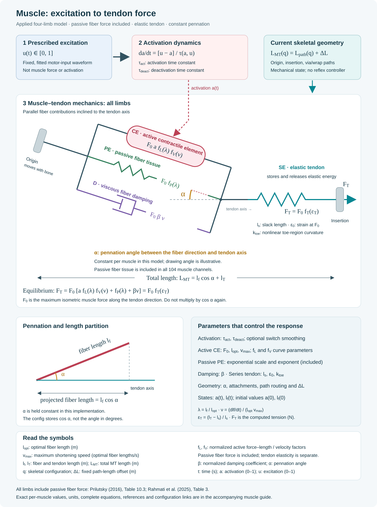

<!-- Generated by Code/simulation_tools/generate_github_guides.py -->

# Documentation

[Project home](../README.md) · [Folder guide](project_structure.md)

## Fully forward: excitation drives one coupled four-limb body

**Muscle excitation is the only prescribed motor input. The right and left forelimbs and the right and left hindlimbs are solved together through mechanically coupled body dynamics; they are not four independent simulations.**

From the initial state, model parameters, gravity and ground-contact laws, the calculation proceeds as **excitation → activation → muscle forces transmitted through elastic tendons → joint loading and coupled movement ↔ paw contact and GRFs**. A change in one limb can therefore change loading and movement in the other limbs.

Experimental kinematics and GRFs are used for offline fitting and comparison, not imposed during the forward run. There is no sensory-feedback controller, CPG, tracking controller, online optimization or stride-state reset. The GUI animates the computed forward trial.

The current body mechanics are sagittal, not unrestricted three-dimensional balance. Excitation is the only prescribed motor command; movement still depends on initial conditions, mechanics, gravity and contact.

**Before interpreting the results:** [What was calibrated: experimental EMG, fitted excitation, mechanical parameters and the forward calculation](calibration_summary.md).

### [Scientific methods](model_methods.md)

Every governing equation with immediately defined symbols.

### [Code flowchart](code_flowchart.md)

Follow the calculation and open the matching source.

### [Edit the model](configuration.md)

Parameters, fixed input curves and muscle attachments.

### [Results](results.md)

Computed motion, experimental comparisons and limitations.

### [Reproduction](reproducibility.md)

Installation, run commands and expected outcomes.

### [Scientific papers](References/README.md)

DOIs, BibTeX, source contributions and article copies.

## How excitation becomes muscle force

Activation drives a Hill-type contractile element. In all 104 forelimb and hindlimb channels, active and passive fiber forces and damping act in parallel, with an elastic tendon in series. Current geometry and a constant pennation angle determine how total muscle–tendon length divides into fiber and tendon length.

The same Hill-type architecture applies to all 104 muscle channels. Passive fiber tissue and damping act in parallel with the contractile element; an elastic tendon acts in series. Maximum isometric force is already tendon-projected.

[Explore the diagram, select any of the 104 muscles, and inspect all parameters and equations →](muscle_model.md)

## Understand the parameters

**Source value** is the verified number from the author’s original work or cited literature, in the listed units. **Value used in this model** is the number actually applied in the simulation. **What changed and why** identifies the difference and documented reason. If the source is unavailable, the table explicitly says “Not established”; that value is an assumption, estimate or fitted value.

[Open the source-to-model parameter tables](parameter_tables.md).
