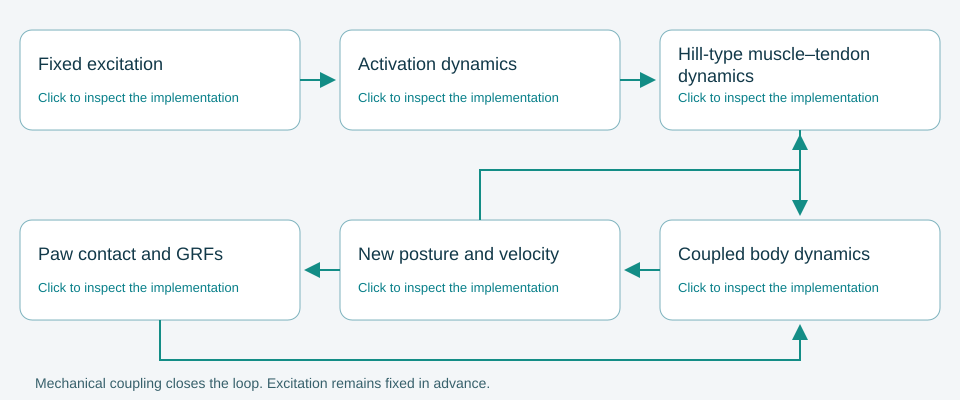

<!-- Generated by Code/simulation_tools/generate_github_guides.py -->

# Code map · from input to motion

[Project home](../README.md) · [Folder guide](project_structure.md)

The muscle contains an active contractile element, passive elastic fiber tissue and viscous fiber damping in parallel. This muscle assembly acts in series with an elastic tendon; pennation is included in the fiber–tendon geometry.

**What coupled body dynamics means.** All four limbs and the trunk belong to one connected mechanical system. The solver combines muscle forces, gravity and paw-contact forces to calculate their motion together. For example, the hind-paw ground force acts through the pelvis and trunk and affects forelimb loading. All four limbs participate in the same mechanical system. This is mechanical coupling; there is no sensory motor correction in this release.

**GRFs** means ground-reaction forces: forces exerted by the ground on each paw, calculated from its contact with the surface.

## Read the model in this order

1. [muscle_excitation.py](../Code/neuromechanics/muscle_excitation.py): Fixed excitation
2. [activation_derivative.py](../Code/neuromechanics/activation_derivative.py): Activation dynamics
3. [muscle_tendon_dynamics.py](../Code/neuromechanics/muscle_tendon_dynamics.py): Hill-type muscle–tendon dynamics
4. [multibody_system_dynamics.py](../Code/neuromechanics/multibody_system_dynamics.py): Coupled body dynamics
5. [advance_neuromechanical_timestep.py](../Code/neuromechanics/advance_neuromechanical_timestep.py): New posture and velocity
6. [foot_contact_model.py](../Code/neuromechanics/foot_contact_model.py): Paw contact and GRFs

The numbered links above open the actual Python source on GitHub; diagram boxes are clickable in the downloaded HTML. Its “Open or save Python source” link opens the actual file; whether the browser launches an editor or downloads it depends on the operating system. In an IDE, open the same file under Code/neuromechanics.
