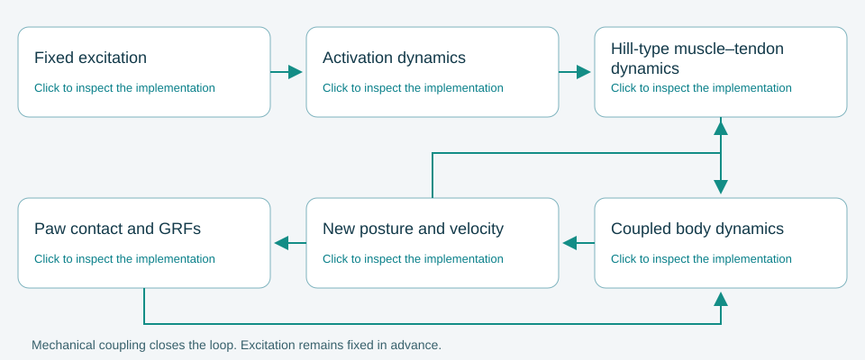

<!-- Generated by Code/simulation_tools/generate_github_guides.py -->

# Methods · equations and implementation

[Project home](../README.md) · [Folder guide](project_structure.md)

[Illustrated Hill-type muscle: excitation, activation, elastic tendon, passive force, damping and pennation, with a per-muscle parameter selector.](muscle_model.md)

**Before interpreting the results:** [What was calibrated: experimental EMG, fitted excitation, mechanical parameters and the forward calculation](calibration_summary.md).

**What this model predicts.** Fixed muscle excitations and one initial state drive activation, Hill-type muscle dynamics with an elastic tendon, contact and a shared sagittal skeleton. No recorded joint trajectory, GRF, neural feedback, CPG, online optimizer or corrective torque drives the walking calculation. Offline fitting informed the supplied parameters and waveform. This is an assembled research model, not an exact reproduction of any one paper.

There are 21 generalized coordinates and 104 actuator channels: 14 per hindlimb and 38 per forelimb (the original 9 forelimb groups plus toe and shoulder-girdle paths). Full-body means all four limbs share the dynamic equations; it does not mean unrestricted three-dimensional balance.

## Inputs, states and activation

### 1. State and initialization

$$
\mathbf{x}=(\mathbf{q},\dot{\mathbf{q}},\mathbf{a},\mathbf{l}_f,\boldsymbol{\xi}),\quad\mathbf{x}(0)=\mathbf{x}_0\tag{1}
$$

q: generalized positions (hinges in rad, sliders in m); q̇: velocities (rad/s or m/s); a: activation (0–1); l_f: muscle fiber lengths (m); ξ: two-dimensional pad shear displacement (m). The saved initial state x₀ includes posture, velocity, activation, fiber length and shear memory. It is applied once; no resets occur at stride boundaries.

Code: [apply_initial_parameter_file.py](../Code/neuromechanics/apply_initial_parameter_file.py).

### 2. Prescribed periodic excitation

$$
u_i(t)=\operatorname{clip}_{[0,1]}U_i\left(\operatorname{frac}\frac{t}{T}\right)\tag{2}
$$

i: muscle channel; uᵢ: applied dimensionless excitation (0–1); Uᵢ: linearly interpolated fixed input table; t: simulation time (s); T: input period, 0.6833333333 s; frac: fractional part of the cycle. The same prescribed excitation cycle repeats throughout the calculation, independently of motion and forces.

Code: [muscle_excitation.py](../Code/neuromechanics/muscle_excitation.py).

### 3. Activation dynamics

$$
\dot a_i=\frac{u_i-a_i}{\tau_i},\qquad \tau_i=\begin{cases}\tau_{act,i}(0.5+1.5a_i)&u_i>a_i\\ \tau_{deact,i}/(0.5+1.5a_i)&u_i\leq a_i\end{cases}\tag{3}
$$

aᵢ: activation (0–1); uᵢ: excitation (0–1); τ_act and τ_deact: activation and deactivation time constants (s), from activation.py. q and GRFs do not enter this input law. Native MuJoCo integrates activation. The equation is the unsmoothed branch; switch_smoothing_width is also exposed in the parameters. The current values are checked in the parameter table.

Code: [activation_derivative.py](../Code/neuromechanics/activation_derivative.py). [MuJoCo muscle activation](https://mujoco.readthedocs.io/en/stable/modeling.html#muscle-actuators).

## Muscle–tendon geometry and force

### 4. Path length and fiber–tendon partition

$$
L_{MT,i}(\mathbf q)=L_{path,i}(\mathbf q)+\Delta L_i,\qquad l_{T,i}=L_{MT,i}-l_{f,i}\cos\alpha_i\tag{4}
$$

L_MT: whole muscle–tendon length (m), not fiber length; L_path: routed origin/via/wrap/insertion length (m); ΔL: fixed path-length offset (m); l_T: tendon length (m); l_f: fiber length (m); α: constant pennation angle. Editable attachment coordinates are local to their named bones. Source pulley routing and native wrapping are described in the attachment map.

Code: [muscle_tendon_dynamics.py](../Code/neuromechanics/muscle_tendon_dynamics.py). Source geometry: [Rahmati et al.](References/README.md#Rahmati2025); Rahmati’s MATLAB hindlimb Model 3 parameters. Elastic tendon mechanics are a model extension.

### 5. Normalized fiber variables

$$
\lambda_i=\frac{l_{f,i}}{l_{opt,i}},\qquad\nu_i=\frac{\dot l_{f,i}}{l_{opt,i}v_{max,i}}\tag{5}
$$

λ: dimensionless normalized fiber length; ν: normalized fiber velocity, positive when lengthening; l_opt: optimal fiber length (m); v_max: positive maximum-shortening-speed magnitude in optimal lengths/s. l_opt v_max is a physical speed in m/s.

Code: [solve_elastic_muscle_equilibrium.py](../Code/neuromechanics/solve_elastic_muscle_equilibrium.py).

### 6. Active force–length curve

$$
f_L(\lambda_i)=\exp\left[-\left|\frac{\lambda_i^{1.55}-1}{0.55}\right|^{\rho_i}\right]\tag{6}
$$

f_L: dimensionless active force–length multiplier; λ: normalized fiber length; ρᵢ: channel-specific exponent. The constants 1.55 and 0.55 are editable in formulation_constants.py. The applied muscle parameters select the source MATLAB curve rather than the unused generic piecewise fallback.

Code: [muscle_force_length_velocity.py](../Code/neuromechanics/muscle_force_length_velocity.py). Rahmati’s MATLAB MTForce.m; [Rahmati et al. (2025)](References/README.md#Rahmati2025).

### 7. Applied smooth force–velocity curve

$$
f_V(\nu)=\max\{0,d_1\operatorname{asinh}(d_2\nu+d_3)+d_4\}\tag{7}
$$

f_V: dimensionless velocity multiplier; ν: normalized fiber velocity; d₁ = −0.3211346128, d₂ = −8.149, d₃ = −0.374, d₄ = 0.8825327733. Current channels enable this curve. Source shortening/lengthening coefficients remain available but inactive when this flag is 1. Excursions outside the stated normalized domain [−1,1] are diagnostics, not validated muscle behavior.

Code: [muscle_force_velocity_degroote.py](../Code/neuromechanics/muscle_force_velocity_degroote.py). [De Groote et al. (2016)](References/README.md#DeGroote2016); corrected coefficients from OpenSim. This is explicitly an adaptation of the original cat muscle law.

### 8. Optional source velocity curve

$$
f_V^{src}(\nu)=\begin{cases}\max\{0,c_i(1+\nu)/(c_i-\nu)\}&\nu<0\\ [e_i+(1.8+0.8e_i)\nu]/(e_i+\nu)&\nu\geq0\end{cases}\tag{8}
$$

cᵢ and eᵢ: dimensionless source-shortening and source-lengthening curvature values in muscle_tendon.py; ν: normalized fiber velocity. This branch is used only if degroote_force_velocity_enabled is 0. It is retained for transparent inspection; changing that flag creates a different mechanical model requiring a new trial.

Code: [muscle_force_length_velocity.py](../Code/neuromechanics/muscle_force_length_velocity.py).

### 9. Passive fiber force

$$
f_{PE}(\lambda)=\begin{cases}\dfrac{0.0075}{11.6}\left[\exp(11.6(\lambda-1))-1\right]&\lambda>1\ \text{and enabled}\\0&\text{otherwise}\end{cases}\tag{9}
$$

f_PE: passive tension normalized by tendon-projected maximum isometric force F0; lambda = l_f/l_opt is normalized fiber length, dimensionless. All 104 current channels (28 hindlimb and 76 forelimb) have passive_fiber_enabled = 1. The branch contributes zero when lambda <= 1 and positive tension when lambda > 1. Published coefficients 0.0075 and 11.6 are from Prilutsky et al. (2016), Table 10.3, and Rahmati et al. (2025), Table 3. Rectification to prevent compression and the exponent cap of 50 are implementation adaptations. The same normalized law is extended to added toe/girdle channels; this is not a measurement of each channel's passive force curve. F_PE = F0 f_PE is included inside fiber/tendon equilibrium.

Code: [muscle_force_length_velocity.py](../Code/neuromechanics/muscle_force_length_velocity.py).

[Passive fiber mechanics: published coefficients, assumptions and stretch verification.](passive_fiber_mechanics.md)

### 10. Elastic tendon law

$$
\epsilon_i=\frac{l_{T,i}-l_{s,i}}{l_{s,i}},\quad f_T(\epsilon)=\begin{cases}0&\epsilon\leq0\\0.33\dfrac{e^{k\epsilon/\epsilon_{toe}}-1}{e^k-1}&0<\epsilon\leq\epsilon_{toe}\\0.33+\dfrac{0.67(\epsilon-\epsilon_{toe})}{\epsilon_0-\epsilon_{toe}}&\epsilon>\epsilon_{toe}\end{cases}\tag{10}
$$

ε: tendon strain; l_T: tendon length (m); l_s: slack tendon length (m); f_T: normalized tension; ε₀: strain at maximum isometric tendon force; ε_toe: toe-region transition strain; k = 3: exponential toe curvature. This custom exponential-to-linear tendon law is an implementation assumption, not an identified tendon law for every cat muscle.

Code: [elastic_tendon_force.py](../Code/neuromechanics/elastic_tendon_force.py).

### 11. Continuous tendon transition

$$
\epsilon_{toe}=\epsilon_0\frac{0.33ke^k}{0.33ke^k+0.67(e^k-1)},\qquad F_{T,i}=F_{0,i}f_T(\epsilon_i)\tag{11}
$$

ε_toe and ε₀: dimensionless strains; k: toe curvature; F_T: tendon tension (N); F₀: maximum isometric force already projected along the tendon (N). This choice makes force and slope continuous at the transition and gives f_T(ε₀)=1. Do not multiply F₀ by cos α again.

Code: [elastic_tendon_transition.py](../Code/neuromechanics/elastic_tendon_transition.py).

### 12. Fiber–tendon equilibrium and time discretization

$$
f_T(\epsilon_i)-a_i f_L(\lambda_i)f_V(\nu_i)-f_{PE}(\lambda_i)-\beta_i\nu_i=0,\qquad\dot l_{f,i}^{n+1}=\frac{l_{f,i}^{n+1}-l_{f,i}^{n}}{h}\tag{12}
$$

βᵢ: normalized fiber damping coefficient; n: time-step index; h: integration step (s); all force-balance terms are dimensionless tendon-direction forces. Safeguarded Newton iteration with bisection fallback solves for l_f at each step. Fiber bounds and residuals are reported. Pennation enters length geometry; the force scale is tendon-projected. This is a massless series equilibrium model.

Code: [solve_elastic_muscle_equilibrium.py](../Code/neuromechanics/solve_elastic_muscle_equilibrium.py).

### 13. Generalized muscle force and moment arms

$$
r_{ij}=-\frac{\partial L_{MT,i}}{\partial q_j},\qquad Q_{m,j}=\sum_i r_{ij}F_{T,i}\tag{13}
$$

j: generalized coordinate; rᵢⱼ: signed moment arm (m for a rotational coordinate, dimensionless for a translational coordinate); Q_m: summed generalized muscle force (N m for a hinge, N for a slider). Individual contributions rᵢⱼF_T are saved separately. They exclude passive joint forces, contact and joint reactions. Source moving-route geometry was checked by a virtual-work audit.

Code: [muscle_joint_moments.py](../Code/neuromechanics/muscle_joint_moments.py).

## Paw contact and coupled mechanics

### 14. Normal contact at each pad

$$
\delta_p=\max(0,R_p-z_p),\qquad F_{z,p}=k_{n,p}\delta_p^{3/2}\max(0,1-c_{n,p}v_{z,p})\tag{14}
$$

p: one of 24 pads (six per paw); δ: indentation (m); R: pad radius (m); z: world pad-center height (m) above a ground plane at zero; k_n: normal coefficient (N/m^(3/2)); c_n: dissipation (s/m); v_z: contact-point vertical velocity (m/s), positive upward; F_z: nonnegative vertical force (N). No measured GRF is imposed.

Code: [viscoelastic_paw_pad.py](../Code/neuromechanics/viscoelastic_paw_pad.py). Normal-law concept: [Hunt & Crossley (1975)](References/README.md#HuntCrossley1975). Fitted constants are effective contact parameters, not measured paw tissue properties.

### 15. Tangential trial force

$$
\boldsymbol\xi^*=\boldsymbol\xi^n+h\mathbf v_t,\quad b_{eff}=b_t\min(1,\delta/\delta_d),\quad\mathbf T^*=k_t\boldsymbol\xi^*+b_{eff}\mathbf v_t\tag{15}
$$

ξ: tangential pad displacement (m); v_t: contact-point tangential velocity (m/s); h: timestep (s); b_t: shear damping (N s/m); δ_d = 0.001 m: damping ramp depth; k_t: shear stiffness (N/m); T*: trial tangential force (N). This is a Kelvin–Voigt shear element combined with a friction slider.

Code: [viscoelastic_paw_pad.py](../Code/neuromechanics/viscoelastic_paw_pad.py).

### 16. Friction limit and slip return

$$
\mathbf F_t=-\mathbf T^*\min\left(1,\frac{\mu F_z}{\|\mathbf T^*\|}\right),\quad\gamma=\frac{[\|\mathbf T^*\|-\mu F_z]_+}{k_t h+b_{eff}},\quad\boldsymbol\xi^{n+1}=\boldsymbol\xi^*-h\gamma\frac{\mathbf T^*}{\|\mathbf T^*\|}\tag{16}
$$

F_t: tangential contact force (N); μ: dimensionless friction coefficient; [x]₊ = max(0,x); γ: slip-speed correction (m/s). Zero force is handled separately to avoid division by zero. Shear memory resets when the pad unloads. This project’s discrete return map is not MuJoCo’s native friction solver.

Code: [viscoelastic_paw_pad.py](../Code/neuromechanics/viscoelastic_paw_pad.py).

### 17. Paw resultant and body wrench

$$
\mathbf F_{paw}=\sum_{p\in paw}\mathbf F_p,\qquad\boldsymbol\tau_b=\sum_{p\in b}(\mathbf x_p-\mathbf c_b)\times\mathbf F_p\tag{17}
$$

F_paw: resultant GRF (N); F_p: individual pad force (N); x_p: world contact point (m); c_b: body center of mass (m); τ_b: contact moment about that center (N m). Six pad forces are applied to each paw through the same multibody system. Native collisions are disabled for the custom pads to avoid double counting; body-ground collisions still identify a fall.

Code: [sum_paw_contact_forces_and_moments.py](../Code/neuromechanics/sum_paw_contact_forces_and_moments.py).

### 18. Coupled multibody dynamics

$$
\mathbf M(\mathbf q)\ddot{\mathbf q}+\mathbf b(\mathbf q,\dot{\mathbf q})=\mathbf Q_m+\mathbf Q_{passive}+\mathbf J_c^T\mathbf F_c+\mathbf Q_{constraint}\tag{18}
$$

M: generalized mass matrix; b: gravity, Coriolis and centrifugal terms; q̈: generalized acceleration; Q_m: muscle forces/moments; Q_passive: passive joint spring/damping forces; J_c: contact Jacobian; F_c: contact forces; Q_constraint: native joint-limit/other constraint forces. All four limbs are mechanically coupled through M, the torso and contacts. The planar root translates forward/vertically and pitches; lateral balance is excluded.

Code: [multibody_system_dynamics.py](../Code/neuromechanics/multibody_system_dynamics.py). [MuJoCo computation](https://mujoco.readthedocs.io/en/stable/computation/index.html).

### 19. Passive joint forces

$$
Q_{passive,j}=-k_j(q_j-q_{ref,j})-b_j\dot q_j\tag{19}
$$

kⱼ: passive joint stiffness (N m/rad for hinges, N/m for sliders); bⱼ: joint damping (N m s/rad or N s/m); q_ref: resting position (rad or m). This expression describes configured spring/damping terms; native limit/friction constraints remain separate. These are mechanical effects, not excitation corrections.

Code: [multibody_system_dynamics.py](../Code/neuromechanics/multibody_system_dynamics.py).

**Numerical order matters.** The implementation is partitioned: evaluate u at the current time; advance the coupled skeleton and native activation using the preceding muscle/contact forces; update route geometry; solve new fiber/tendon forces; update pad forces and shear memory. The next step uses these refreshed forces. Default h = 0.00012499237851350527 s. Saved output occurs every 40 steps, approximately 0.004999695 s. GUI frame rate does not set the integration step. Time-step convergence should be assessed by recomputing with a smaller step and comparing outputs over the same interval.

## Comparison, normalization and reproducibility

### 20. Anatomical angle conventions

$$
\boldsymbol\theta_H=( -q_{hip},\ \pi+q_{knee},\ \pi-q_{ankle},\ \pi-q_{MTP}),\quad\boldsymbol\theta_F=(\pi+q_{shoulder},\ \pi-q_{elbow},\ \pi-q_{wrist},\ \pi-q_{MCP})\tag{20}
$$

θ_H and θ_F: source sagittal anatomical angle conventions (rad; displayed/exported also in degrees); q: native hinge angles. The same transforms are applied to the predictions and references. The left-hind reference includes the saved assembly correction and is explicitly assumed rather than measured.

Code: [write_simulation_results.py](../Code/neuromechanics/write_simulation_results.py).

### 21. Fixed reference clocks

$$
\phi_s(t)=\operatorname{frac}(t/T+\Delta_s),\qquad\boldsymbol\Delta=(1.0,0.5,0.75,1.25)\tag{21}
$$

s: limb order LH, RH, LF, RF; φ: reference cycle phase; T: common period (s); Δ: fixed phase offsets. The forelimb original period was 0.6878574832 s. These are comparison conventions, not phase shifts optimized separately to improve a plotted result. No dynamic time warping or filtering is used.

Code: [experimental_comparison_targets.py](../Code/neuromechanics/experimental_comparison_targets.py).

### 22. Reported errors and display normalization

$$
RMSE_y=\sqrt{\frac1N\sum_{n=1}^N(y_n-y_n^{ref})^2},\quad\widetilde u_i=u_i/u_{peak,i}^{intact},\quad\widetilde a_i=a_i/u_{peak,i}^{intact}\tag{22}
$$

y: a particular angle or force channel; y_ref: corresponding fixed-clock reference; N: compared samples; RMSE: root mean squared error in that channel’s units. ũ and ã: optional GUI display values divided by the same fixed intact input peak (with a 0.02 denominator floor). EMG is independently peak-normalized. Raw u and a are saved without this display rescaling.

Code: [compare_simulation_with_experiment.py](../Code/neuromechanics/compare_simulation_with_experiment.py).

The prescribed excitation U(t), selected mechanical parameters and initial state were estimated offline. The passive fiber curve coefficients are published values, not fitted coefficients. A simulation run uses the supplied configuration without re-estimation. The estimation guide identifies the available method records and the boundary between reproducing a forward calculation and repeating parameter estimation. Agreement with calibration data is not independent validation.

## Symbol glossary

| Symbol / group | Definition and units |
| --- | --- |
| Equation 1: State and initialization | q: generalized positions (hinges in rad, sliders in m); q̇: velocities (rad/s or m/s); a: activation (0–1); l_f: muscle fiber lengths (m); ξ: two-dimensional pad shear displacement (m). The saved initial state x₀ includes posture, velocity, activation, fiber length and shear memory. It is applied once; no resets occur at stride boundaries. |
| Equation 2: Prescribed periodic excitation | i: muscle channel; uᵢ: applied dimensionless excitation (0–1); Uᵢ: linearly interpolated fixed input table; t: simulation time (s); T: input period, 0.6833333333 s; frac: fractional part of the cycle. The same prescribed excitation cycle repeats throughout the calculation, independently of motion and forces. |
| Equation 3: Activation dynamics | aᵢ: activation (0–1); uᵢ: excitation (0–1); τ_act and τ_deact: activation and deactivation time constants (s), from activation.py. q and GRFs do not enter this input law. Native MuJoCo integrates activation. The equation is the unsmoothed branch; switch_smoothing_width is also exposed in the parameters. The current values are checked in the parameter table. |
| Equation 4: Path length and fiber–tendon partition | L_MT: whole muscle–tendon length (m), not fiber length; L_path: routed origin/via/wrap/insertion length (m); ΔL: fixed path-length offset (m); l_T: tendon length (m); l_f: fiber length (m); α: constant pennation angle. Editable attachment coordinates are local to their named bones. Source pulley routing and native wrapping are described in the attachment map. |
| Equation 5: Normalized fiber variables | λ: dimensionless normalized fiber length; ν: normalized fiber velocity, positive when lengthening; l_opt: optimal fiber length (m); v_max: positive maximum-shortening-speed magnitude in optimal lengths/s. l_opt v_max is a physical speed in m/s. |
| Equation 6: Active force–length curve | f_L: dimensionless active force–length multiplier; λ: normalized fiber length; ρᵢ: channel-specific exponent. The constants 1.55 and 0.55 are editable in formulation_constants.py. The applied muscle parameters select the source MATLAB curve rather than the unused generic piecewise fallback. |
| Equation 7: Applied smooth force–velocity curve | f_V: dimensionless velocity multiplier; ν: normalized fiber velocity; d₁ = −0.3211346128, d₂ = −8.149, d₃ = −0.374, d₄ = 0.8825327733. Current channels enable this curve. Source shortening/lengthening coefficients remain available but inactive when this flag is 1. Excursions outside the stated normalized domain [−1,1] are diagnostics, not validated muscle behavior. |
| Equation 8: Optional source velocity curve | cᵢ and eᵢ: dimensionless source-shortening and source-lengthening curvature values in muscle_tendon.py; ν: normalized fiber velocity. This branch is used only if degroote_force_velocity_enabled is 0. It is retained for transparent inspection; changing that flag creates a different mechanical model requiring a new trial. |
| Equation 9: Passive fiber force | f_PE: passive tension normalized by tendon-projected maximum isometric force F0; lambda = l_f/l_opt is normalized fiber length, dimensionless. All 104 current channels (28 hindlimb and 76 forelimb) have passive_fiber_enabled = 1. The branch contributes zero when lambda <= 1 and positive tension when lambda > 1. Published coefficients 0.0075 and 11.6 are from Prilutsky et al. (2016), Table 10.3, and Rahmati et al. (2025), Table 3. Rectification to prevent compression and the exponent cap of 50 are implementation adaptations. The same normalized law is extended to added toe/girdle channels; this is not a measurement of each channel's passive force curve. F_PE = F0 f_PE is included inside fiber/tendon equilibrium. |
| Equation 10: Elastic tendon law | ε: tendon strain; l_T: tendon length (m); l_s: slack tendon length (m); f_T: normalized tension; ε₀: strain at maximum isometric tendon force; ε_toe: toe-region transition strain; k = 3: exponential toe curvature. This custom exponential-to-linear tendon law is an implementation assumption, not an identified tendon law for every cat muscle. |
| Equation 11: Continuous tendon transition | ε_toe and ε₀: dimensionless strains; k: toe curvature; F_T: tendon tension (N); F₀: maximum isometric force already projected along the tendon (N). This choice makes force and slope continuous at the transition and gives f_T(ε₀)=1. Do not multiply F₀ by cos α again. |
| Equation 12: Fiber–tendon equilibrium and time discretization | βᵢ: normalized fiber damping coefficient; n: time-step index; h: integration step (s); all force-balance terms are dimensionless tendon-direction forces. Safeguarded Newton iteration with bisection fallback solves for l_f at each step. Fiber bounds and residuals are reported. Pennation enters length geometry; the force scale is tendon-projected. This is a massless series equilibrium model. |
| Equation 13: Generalized muscle force and moment arms | j: generalized coordinate; rᵢⱼ: signed moment arm (m for a rotational coordinate, dimensionless for a translational coordinate); Q_m: summed generalized muscle force (N m for a hinge, N for a slider). Individual contributions rᵢⱼF_T are saved separately. They exclude passive joint forces, contact and joint reactions. Source moving-route geometry was checked by a virtual-work audit. |
| Equation 14: Normal contact at each pad | p: one of 24 pads (six per paw); δ: indentation (m); R: pad radius (m); z: world pad-center height (m) above a ground plane at zero; k_n: normal coefficient (N/m^(3/2)); c_n: dissipation (s/m); v_z: contact-point vertical velocity (m/s), positive upward; F_z: nonnegative vertical force (N). No measured GRF is imposed. |
| Equation 15: Tangential trial force | ξ: tangential pad displacement (m); v_t: contact-point tangential velocity (m/s); h: timestep (s); b_t: shear damping (N s/m); δ_d = 0.001 m: damping ramp depth; k_t: shear stiffness (N/m); T*: trial tangential force (N). This is a Kelvin–Voigt shear element combined with a friction slider. |
| Equation 16: Friction limit and slip return | F_t: tangential contact force (N); μ: dimensionless friction coefficient; [x]₊ = max(0,x); γ: slip-speed correction (m/s). Zero force is handled separately to avoid division by zero. Shear memory resets when the pad unloads. This project’s discrete return map is not MuJoCo’s native friction solver. |
| Equation 17: Paw resultant and body wrench | F_paw: resultant GRF (N); F_p: individual pad force (N); x_p: world contact point (m); c_b: body center of mass (m); τ_b: contact moment about that center (N m). Six pad forces are applied to each paw through the same multibody system. Native collisions are disabled for the custom pads to avoid double counting; body-ground collisions still identify a fall. |
| Equation 18: Coupled multibody dynamics | M: generalized mass matrix; b: gravity, Coriolis and centrifugal terms; q̈: generalized acceleration; Q_m: muscle forces/moments; Q_passive: passive joint spring/damping forces; J_c: contact Jacobian; F_c: contact forces; Q_constraint: native joint-limit/other constraint forces. All four limbs are mechanically coupled through M, the torso and contacts. The planar root translates forward/vertically and pitches; lateral balance is excluded. |
| Equation 19: Passive joint forces | kⱼ: passive joint stiffness (N m/rad for hinges, N/m for sliders); bⱼ: joint damping (N m s/rad or N s/m); q_ref: resting position (rad or m). This expression describes configured spring/damping terms; native limit/friction constraints remain separate. These are mechanical effects, not excitation corrections. |
| Equation 20: Anatomical angle conventions | θ_H and θ_F: source sagittal anatomical angle conventions (rad; displayed/exported also in degrees); q: native hinge angles. The same transforms are applied to the predictions and references. The left-hind reference includes the saved assembly correction and is explicitly assumed rather than measured. |
| Equation 21: Fixed reference clocks | s: limb order LH, RH, LF, RF; φ: reference cycle phase; T: common period (s); Δ: fixed phase offsets. The forelimb original period was 0.6878574832 s. These are comparison conventions, not phase shifts optimized separately to improve a plotted result. No dynamic time warping or filtering is used. |
| Equation 22: Reported errors and display normalization | y: a particular angle or force channel; y_ref: corresponding fixed-clock reference; N: compared samples; RMSE: root mean squared error in that channel’s units. ũ and ã: optional GUI display values divided by the same fixed intact input peak (with a 0.02 denominator floor). EMG is independently peak-normalized. Raw u and a are saved without this display rescaling. |

[Every applied parameter, original/baseline values, units and provenance →](parameter_tables.md)
