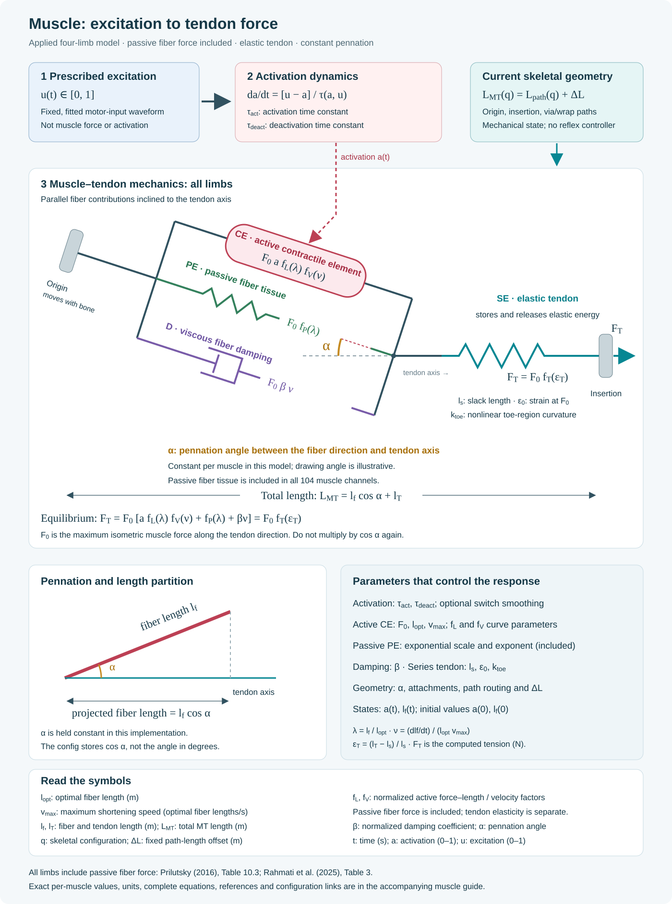

<!-- Generated by Code/simulation_tools/generate_github_guides.py -->

# How excitation produces muscle force

[Project home](../README.md) · [Folder guide](project_structure.md)

**Excitation is a command; activation is a dynamic state; tendon force is a mechanical result.** Force depends on activation, fiber length and velocity, tendon stretch, pennation and muscle parameters. The same excitation need not produce the same force when the limb is in a different mechanical state.

F0 is the **maximum isometric muscle force along the tendon direction** (N): the active reference force at full activation, optimal fiber length and zero fiber velocity, including the constant pennation projection. It is not tendon failure strength or a ceiling on total tendon tension. The tendon transmits force through elastic stretch. The parameter `max_isometric_muscle_force_along_tendon_N` stores this value; do not apply the pennation cosine again.

## The elements actually used in this analysis

**Passive fiber force is included in all 104 channels: 76 forelimb and 28 hindlimb.** Elastic tendons and fiber damping are included in both. The figures show the applied equations, not an optional menu of elements.

[Passive force–length relationship and verification](passive_fiber_mechanics.md)

All four limbs: passive fiber branch included.

Project-specific schematic, not an anatomical scale drawing or a figure copied from a paper. Fiber contributions are written in the implemented tendon-force normalization. 

[Open the scalable figure](Figures_and_Videos/hill_muscle_model.svg) · 

[Enlarge the main panel with pennation angle α](Figures_and_Videos/hill_muscle_pennation_detail.svg).

### 1. Motor command

u(t), from 0 to 1, is read from the fixed excitation table. The same prescribed cycle is repeated throughout the forward calculation.

### 2. Activation dynamics

Activation a(t) rises and falls with finite activation/deactivation time constants. It does not instantaneously become equal to excitation.

### 3. Mechanical equilibrium

The elastic solver finds fiber length such that tendon tension balances active, passive and damping contributions. Tendon length changes as the total path and fiber length change.

### 4. Coupled movement

The resulting tendon force acts along the muscle path. Its moment arms convert it to joint loading. All four limbs, the trunk and paw contacts participate in the coupled forward dynamics.

## What is each element?

| Element | Meaning | Parameters / states |
| --- | --- | --- |
| CE: active contractile element | Activation-dependent force multiplied by force–length and force–velocity factors. | a, F0, lopt, vmax, active exponent ρ; shared curve constants p, w and d1–d4. |
| PE: parallel elastic element | Included for all 104 channels in the current analysis. It produces tensile force when fiber length exceeds optimal length. It is distinct from tendon elasticity. | Passive switch sP; scale cP; exponent kP; normalized fiber length λ. |
| D: viscous fiber damping | Velocity-dependent contribution βν to normalized equilibrium. Its sign follows fiber velocity; it is not a separate neural input. | β, ν; ν is positive when the fiber lengthens. |
| SE: series elastic tendon | No tensile force at or below slack length; nonlinear exponential toe region followed by a linear region. Tendon stretch is a computed outcome. | ls, ε0, ktoe and F0. ε0 is tendon strain when force equals F0. |
| Pennation and geometry | The fiber makes a constant angle α with the tendon axis. LMT = lf cos α + lT. Whole MT length comes from origin/insertion, via/wrap paths and a fixed length offset. | cos α, ΔL and attachment/routing geometry; q is the current skeletal configuration. |
| Initial state and integration | a(0) and lf(0) initialize the muscle once. A backward-Euler fiber-velocity estimate and safeguarded force-equilibrium solve update fiber length. | Initial activation, fiber length, mechanical time step and numerical tolerances. |

**Two implementation details:** Passive fiber force is ON in all channels. It can nevertheless be zero when a fiber is shorter than its passive stretch threshold. The tendon is elastic in all channels. Also, F0 is the maximum isometric muscle force along the tendon direction; applying an additional cos α factor to the force would double-project it. The implementation uses α in the length partition and holds it constant.

## Passive fiber force and its sources

The current model uses the passive exponential in Prilutsky et al. (2016), Table 10.3, and Rahmati et al. (2025), Table 3, with coefficients 0.0075 and 11.6. It is enabled in all limb channels, inside the elastic force-equilibrium solve. This constitutive law is part of the muscle equilibrium equations for every limb.

Zeroing compressive values and limiting the exponent for overflow protection are explicit adaptations. Extending one normalized law to added channels is an assumption, not muscle-specific passive calibration. The passive curve coefficients are taken from the cited publications; they are not fitted to this walking trial. [Passive-force equation and stretch verification](passive_fiber_mechanics.md).

## Inspect the parameters of every muscle

Use the [complete parameter tables](parameter_tables.md) for units, source values and applied values, or inspect the [per-muscle data](muscle_model_parameters.json). The [attachment map](../Data/Model_Parameters/ATTACHMENT_MAP.md) gives origins, insertions and routing. Edit the linked configuration files and start a new simulation to apply changes. The downloaded HTML also provides a muscle selector.

## Shared curve constants

These constants are shared by muscle channels. The selected muscle’s exponent, strength, lengths, speed and switches still differ by channel. Edit [formulation_constants.py](../Data/Model_Parameters/formulation_constants.py) and start a new process to apply a change.

| Parameter | Unit | Value | Meaning |
| --- | --- | --- | --- |
| ACTIVE_LENGTH_POWER | 1 | 1.55 | Power p in the active force–length curve; current source shape p = 1.55. |
| ACTIVE_LENGTH_WIDTH | 1 | 0.55 | Width w in the active force–length curve; current source shape w = 0.55. |
| PASSIVE_LENGTH_SCALE | 1 | 0.0075 | Scale cP = 0.0075 in the tension-only passive exponential. |
| PASSIVE_LENGTH_EXPONENT | 1 | 11.6 | Exponent kP = 11.6 controlling passive force rise beyond optimal length. |
| PASSIVE_EXPONENT_CAP | 1 | 50.0 | Numerical overflow safeguard, not a measured tissue property. |
| FV_D1 | 1 | -0.3211346127989808 | De Groote force–velocity coefficient d1. |
| FV_D2 | 1 | -8.149 | De Groote force–velocity coefficient d2. |
| FV_D3 | 1 | -0.374 | De Groote force–velocity coefficient d3. |
| FV_D4 | 1 | 0.8825327733249912 | De Groote force–velocity coefficient d4. |
| TENDON_TOE_CURVATURE | 1 | 3.0 | ktoe: exponential toe-region curvature. Toe-to-linear transition is derived for force and slope continuity. |

The tendon’s normalized force at the toe-region endpoint is fixed at 0.33; the remaining rise to normalized force 1 is 0.67. These constants are in [elastic_tendon_force.py](../Code/neuromechanics/elastic_tendon_force.py) and [elastic_tendon_transition.py](../Code/neuromechanics/elastic_tendon_transition.py), not separate configuration entries. The transition strain is derived from ε0 and ktoe to keep force and stiffness continuous. The exact piecewise equation is below.

## Implemented equations, with every symbol defined

Open each equation to inspect its formulation, definitions and corresponding code. These are the same equations as the full methods guide. The alternative source force–velocity curve is documented but inactive when the De Groote switch is 1.

### 2. Prescribed periodic excitation

i: muscle channel; uᵢ: applied dimensionless excitation (0–1); Uᵢ: linearly interpolated fixed input table; t: simulation time (s); T: input period, 0.6833333333 s; frac: fractional part of the cycle. The same prescribed excitation cycle repeats throughout the calculation, independently of motion and forces.

Code: [muscle_excitation.py](../Code/neuromechanics/muscle_excitation.py).

### 3. Activation dynamics

aᵢ: activation (0–1); uᵢ: excitation (0–1); τ_act and τ_deact: activation and deactivation time constants (s), from activation.py. q and GRFs do not enter this input law. Native MuJoCo integrates activation. The equation is the unsmoothed branch; switch_smoothing_width is also exposed in the parameters. The current values are checked in the parameter table.

Code: [activation_derivative.py](../Code/neuromechanics/activation_derivative.py). [MuJoCo muscle activation](https://mujoco.readthedocs.io/en/stable/modeling.html#muscle-actuators).

### 4. Path length and fiber–tendon partition

L_MT: whole muscle–tendon length (m), not fiber length; L_path: routed origin/via/wrap/insertion length (m); ΔL: fixed path-length offset (m); l_T: tendon length (m); l_f: fiber length (m); α: constant pennation angle. Editable attachment coordinates are local to their named bones. Source pulley routing and native wrapping are described in the attachment map.

Code: [muscle_tendon_dynamics.py](../Code/neuromechanics/muscle_tendon_dynamics.py). Source geometry: [Rahmati et al.](References/README.md#Rahmati2025); Rahmati’s MATLAB hindlimb Model 3 parameters. Elastic tendon mechanics are a model extension.

### 5. Normalized fiber variables

λ: dimensionless normalized fiber length; ν: normalized fiber velocity, positive when lengthening; l_opt: optimal fiber length (m); v_max: positive maximum-shortening-speed magnitude in optimal lengths/s. l_opt v_max is a physical speed in m/s.

Code: [solve_elastic_muscle_equilibrium.py](../Code/neuromechanics/solve_elastic_muscle_equilibrium.py).

### 6. Active force–length curve

f_L: dimensionless active force–length multiplier; λ: normalized fiber length; ρᵢ: channel-specific exponent. The constants 1.55 and 0.55 are editable in formulation_constants.py. The applied muscle parameters select the source MATLAB curve rather than the unused generic piecewise fallback.

Code: [muscle_force_length_velocity.py](../Code/neuromechanics/muscle_force_length_velocity.py). Rahmati’s MATLAB MTForce.m; [Rahmati et al. (2025)](References/README.md#Rahmati2025).

### 7. Applied smooth force–velocity curve

f_V: dimensionless velocity multiplier; ν: normalized fiber velocity; d₁ = −0.3211346128, d₂ = −8.149, d₃ = −0.374, d₄ = 0.8825327733. Current channels enable this curve. Source shortening/lengthening coefficients remain available but inactive when this flag is 1. Excursions outside the stated normalized domain [−1,1] are diagnostics, not validated muscle behavior.

Code: [muscle_force_velocity_degroote.py](../Code/neuromechanics/muscle_force_velocity_degroote.py). [De Groote et al. (2016)](References/README.md#DeGroote2016); corrected coefficients from OpenSim. This is explicitly an adaptation of the original cat muscle law.

### 8. Optional source velocity curve

cᵢ and eᵢ: dimensionless source-shortening and source-lengthening curvature values in muscle_tendon.py; ν: normalized fiber velocity. This branch is used only if degroote_force_velocity_enabled is 0. It is retained for transparent inspection; changing that flag creates a different mechanical model requiring a new trial.

Code: [muscle_force_length_velocity.py](../Code/neuromechanics/muscle_force_length_velocity.py).

### 9. Passive fiber force

f_PE: passive tension normalized by maximum isometric muscle force along the tendon direction F0; lambda = l_f/l_opt is normalized fiber length, dimensionless. All 104 current channels (28 hindlimb and 76 forelimb) have passive_fiber_enabled = 1. The branch contributes zero when lambda <= 1 and positive tension when lambda > 1. Published coefficients 0.0075 and 11.6 are from Prilutsky et al. (2016), Table 10.3, and Rahmati et al. (2025), Table 3. Rectification to prevent compression and the exponent cap of 50 are implementation adaptations. The same normalized law is extended to added toe/girdle channels; this is not a measurement of each channel's passive force curve. F_PE = F0 f_PE is included inside fiber/tendon equilibrium.

Code: [muscle_force_length_velocity.py](../Code/neuromechanics/muscle_force_length_velocity.py).

[Passive fiber mechanics: published coefficients, assumptions and stretch verification.](passive_fiber_mechanics.md)

### 10. Elastic tendon law

ε: tendon strain; l_T: tendon length (m); l_s: slack tendon length (m); f_T: normalized tension; ε₀: strain at maximum isometric muscle force along the tendon direction; ε_toe: toe-region transition strain; k = 3: exponential toe curvature. This custom exponential-to-linear tendon law is an implementation assumption, not an identified tendon law for every cat muscle.

Code: [elastic_tendon_force.py](../Code/neuromechanics/elastic_tendon_force.py).

### 11. Continuous tendon transition

ε_toe and ε₀: dimensionless strains; k: toe curvature; F_T: tendon tension (N); F₀: maximum isometric muscle force along the tendon direction (N). This choice makes force and slope continuous at the transition and gives f_T(ε₀)=1. Do not multiply F₀ by cos α again.

Code: [elastic_tendon_transition.py](../Code/neuromechanics/elastic_tendon_transition.py).

### 12. Fiber–tendon equilibrium and time discretization

βᵢ: normalized fiber damping coefficient; n: time-step index; h: integration step (s); all force-balance terms are dimensionless tendon-direction forces. Safeguarded Newton iteration with bisection fallback solves for l_f at each step. Fiber bounds and residuals are reported. Pennation enters length geometry; the force scale is tendon-projected. This is a massless series equilibrium model.

Code: [solve_elastic_muscle_equilibrium.py](../Code/neuromechanics/solve_elastic_muscle_equilibrium.py).

### 13. Generalized muscle force and moment arms

j: generalized coordinate; rᵢⱼ: signed moment arm (m for a rotational coordinate, dimensionless for a translational coordinate); Q_m: summed generalized muscle force (N m for a hinge, N for a slider). Individual contributions rᵢⱼF_T are saved separately. They exclude passive joint forces, contact and joint reactions. Source moving-route geometry was checked by a virtual-work audit.

Code: [muscle_joint_moments.py](../Code/neuromechanics/muscle_joint_moments.py).

### Numerical solver settings (not tissue properties)

These settings control solution accuracy and geometric safeguards. Read [numerical_parameters.py](../Data/Model_Parameters/numerical_parameters.py) for units and comments. The mechanical time step is in [environment.py](../Data/Model_Parameters/environment.py); the default integration step is approximately 0.000125 s.

| Setting | Value |
| --- | --- |
| MINIMUM_FIBER_LENGTH_RATIO | 0.2 |
| MINIMUM_LENGTH_GAP_M | 1e-09 |
| MAXIMUM_FIBER_ITERATIONS | 48 |
| FIBER_FORCE_TOLERANCE | 1e-10 |
| FIBER_LENGTH_TOLERANCE_M | 1e-12 |
| NEWTON_FALLBACK_ITERATION | 20 |

## If excitation becomes zero, does force vanish immediately?

No. Activation first decays according to its time constant. Stretched tendon can retain tension, and passive fiber force can remain. The evolving muscle–tendon and skeletal states determine how force changes. The model therefore distinguishes zero excitation, zero activation and zero tendon force.

## Scientific sources and project choices

The source muscle geometry/curves are documented with the author’s MATLAB hindlimb Model 3 dataset (bundled under Data/Original_Study_Data/hindlimb), [Rahmati et al.](References/README.md#Rahmati2025) and the [Prilutsky chapter and supporting literature](References/README.md). The applied force–velocity adaptation is described in [muscle_force_velocity_degroote.py](../Code/neuromechanics/muscle_force_velocity_degroote.py) and the methods guide’s De Groote/OpenSim references. Elastic tendon, the constant-pennation formulation, passive-force switches, fitted values and numerical safeguards are disclosed implementation choices; this assembled model is not an exact reproduction of a single paper.

To refresh this page after parameter edits, run `python Code/simulation_tools/create_muscle_model_guide.py` from the repository root. The reusable SVG is in `Documentation/Figures_and_Videos/hill_muscle_model.svg`.
