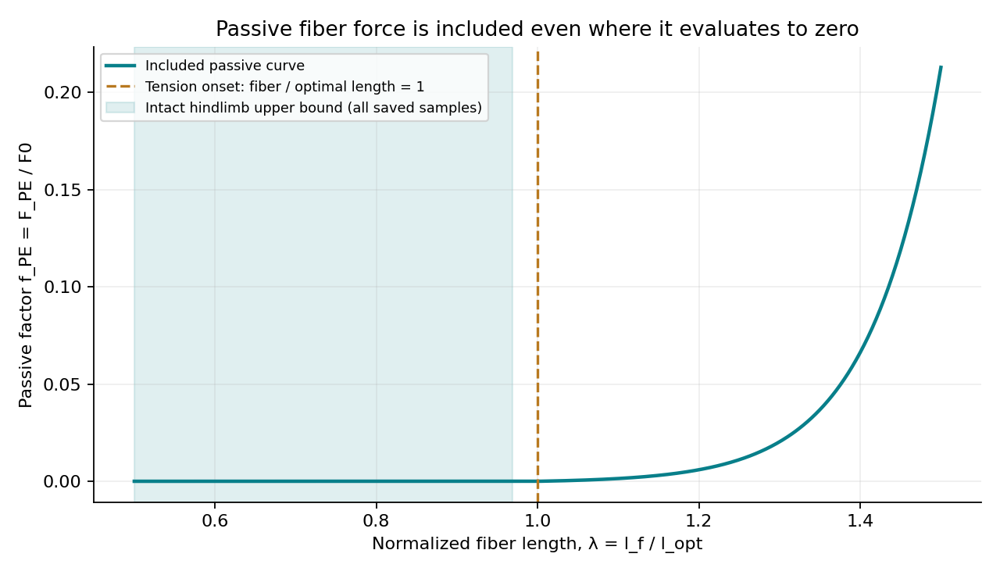

<!-- Generated by Code/simulation_tools/generate_github_guides.py -->

# Passive fiber mechanics · all limbs

[Project home](../README.md) · [Folder guide](project_structure.md)

## Published passive law, included inside the forward solve

${F}_{PE,i}={F}_{0,i}\,\frac{0.0075}{11.6}{[\exp \,(\min \{50,11.6({\lambda }_{i}-1)\})-1]}_{+},\,{\lambda }_{i}=\frac{{l}_{f,i}}{{l}_{opt,i}}$

F_PE,i is the passive fiber contribution projected along the tendon (N); F0,i is the already tendon-projected maximum isometric force (N); l_f,i is current fiber length (m); l_opt,i is optimal fiber length (m); λ_i is their dimensionless ratio. The operator [x]+ means max(0,x). The constants 0.0075 and 11.6 are dimensionless published curve coefficients. The cap 50 is numerical protection. Rectification to tension only and extension of the common curve to added channels are explicit assumptions.

Sources: [Prilutsky, Klishko, Weber & Lemay (2016), Table 10.3](https://doi.org/10.1007/978-1-4939-3267-2_10); [Rahmati et al. (2025), Table 3](https://doi.org/10.1113/JP287448). The same passive coefficients appear in both. The current elastic-tendon, constant-pennation implementation is an adaptation; it is not an exact reproduction of either complete published model.

${F}_{T,i}={F}_{0,i}[{a}_{i}{f}_{L}({\lambda }_{i}){f}_{V}({\nu }_{i})+{f}_{PE}({\lambda }_{i})+{\beta }_{i}{\nu }_{i}],\,{L}_{MT,i}={l}_{f,i}\cos {\alpha }_{i}+{l}_{T,i}$

F_T is tendon tension (N); a is activation (0–1); f_L and f_V are dimensionless active length and velocity factors; f_PE=F_PE/F0; β is dimensionless fiber damping; ν is fiber velocity divided by l_opt v_max (positive in lengthening). L_MT is whole muscle–tendon path length (m); l_T is elastic tendon length (m); α is constant pennation angle. F0 is already tendon-projected: do not multiply the force by cos α again. Passive force affects the equilibrium solution and therefore the tendon force applied to the skeleton; it is not added again in postprocessing.

## Forward simulations and verification

| Simulation | Saved duration (s) | Outcome |
| --- | --- | --- |
| Intact | 59.996 | No fall detected |

The integrator ran the requested horizon; samples are saved about every 5 ms, so the last sample of a 60-second run is 59.996 s. No kinematics or Ground_Reaction_Forces were prescribed, filtered to improve the fit, or corrected online. The simulation remained fully forward with fixed periodic excitation and coupled four-limb dynamics.

## Passive force during intact walking

| Limb group | Enabled channels | Maximum saved λ | Peak passive component (N) |
| --- | --- | --- | --- |
| Hindlimbs | 28 | 0.968825 | 0.000000 |
| Forelimbs | 76 | 1.313115 | 0.775326 |

The intact hindlimb fibers did not reach λ=1 in the saved samples. Their enabled passive elements therefore contribute zero under this particular gait. This does not remove the elements or assume passive tissue is absent. An independent zero-activation stretch test verifies positive tendon tension when λ=1.2.

## Simulation outputs

Each run includes excitation, activation, tendon tension, passive fiber tension, fiber/tendon lengths, generalized and anatomical kinematics, raw four-paw Ground_Reaction_Forces, transmission moment arms, individual and summed muscle moments, and body/paw trajectories. Computed acceleration is a finite difference of saved velocity. No inverse-dynamics reaction moments are claimed. [All-joint and GRF comparisons](results.md) · [Raw results](../Simulation_Results/README.md) · [Simulation hashes and verification records](../Verification/README.md).

[Open or download the simulation video](Figures_and_Videos/walking_simulation.mp4)

## Limits of the result

Sustained numerical walking over 60 s is not complete biological validation. Some joint-angle, vertical-GRF and EMG phase/shape fit criteria still fail. RH is measured, LH is an assumed mirror, and forelimb references are pooled/separate-study data. The model is sagittal. The intact calculation establishes behavior only over the stated intact simulation interval.
