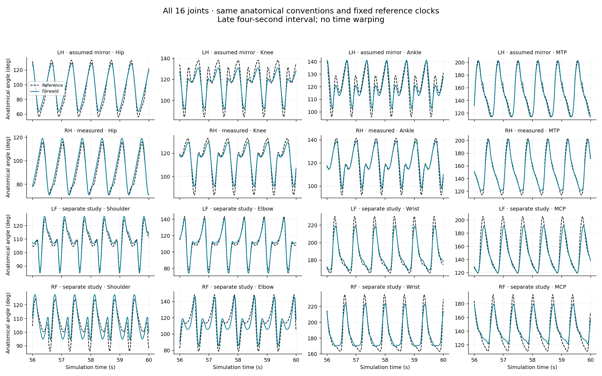
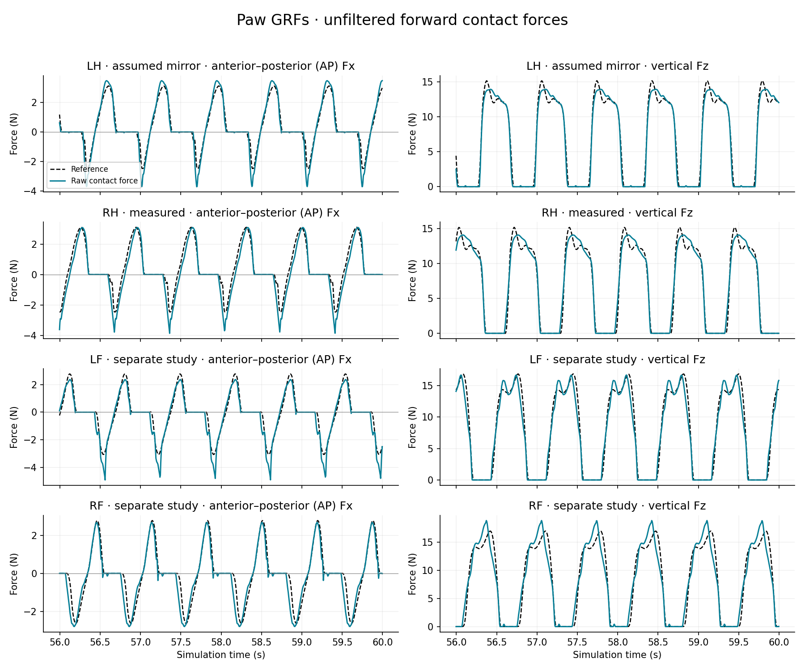
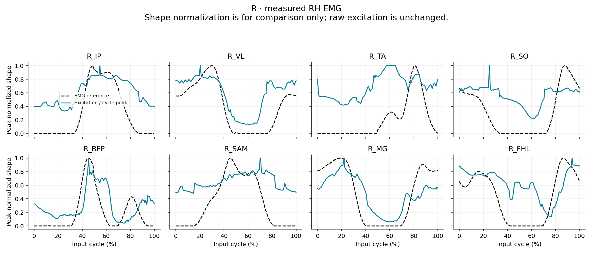
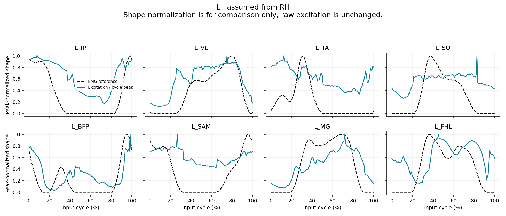
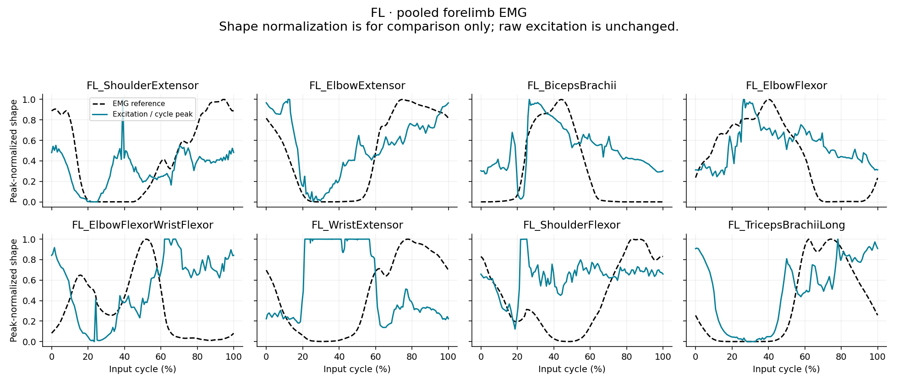
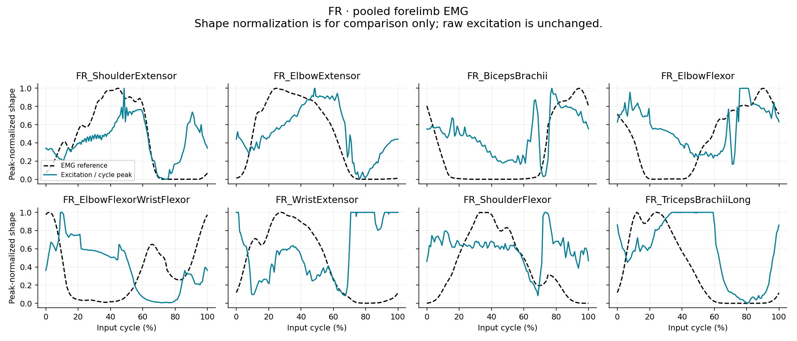

<!-- Generated by Code/simulation_tools/generate_github_guides.py -->

# Results and experimental comparison

[Project home](../README.md) · [Folder guide](project_structure.md)

[**Explore the full trial with a movable four-second window**](../Simulation_Results/Intact_Walking/interactive_experimental_comparison.md). Select joint angles or GRFs, drag the time slider, or jump to Start, Middle or End.

## Intact walking

| Simulation | Saved duration (s) | Outcome |
| --- | --- | --- |
| Intact | 59.996 | No fall detected |

Fixed excitation; elastic tendons; coupled forward dynamics; raw contact forces. The baseline passed the 60-second continuity and rhythmic four-paw contact checks. [Acceptance record including failed experimental-fit criteria](../Simulation_Results/Intact_Walking/walking_quality_metrics.json).

## Comparison with experiment

RMSE uses the final ten seconds at identical reference clocks and anatomical angle conventions. Images show the last four seconds; no phase shift or filtering improves the fit.

| Reference | Joint RMSE (deg), proximal to distal | AP RMSE (N) | Vertical RMSE (N) |
| --- | --- | --- | --- |
| LH — assumed mirror | 5.30, 5.76, 5.30, 3.65 | 0.423 | 0.711 |
| RH — measured | 3.68, 3.77, 3.56, 3.86 | 0.545 | 0.888 |
| LF — separate study | 2.30, 2.67, 4.91, 9.94 | 0.491 | 1.232 |
| RF — separate study | 5.67, 8.12, 6.70, 8.48 | 0.470 | 1.837 |

## Excitation and EMG

Excitation is estimated offline and prescribed throughout each simulation. The plots are peak-normalized for shape comparison only. Quiet-phase excitation and some waveform mismatch remain. Absolute excitation and activation are exported separately.

### R excitation and EMG

### L excitation and EMG

### FL excitation and EMG

### FR excitation and EMG

