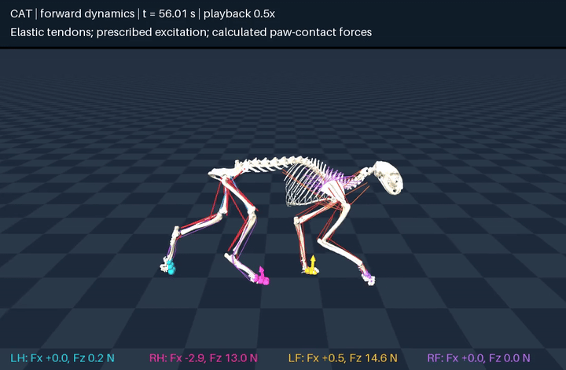
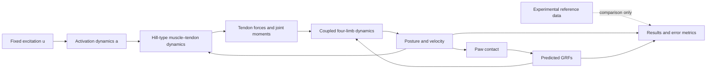
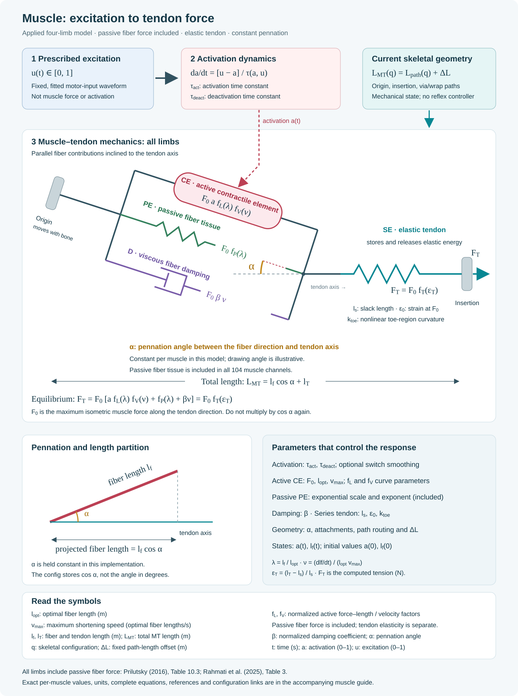

# Cat Full-Body Neuromechanics

**Excitation → activation → elastic muscle–tendon force → coupled motion and paw contact.**

A reproducible sagittal four-limb cat research model: **104 muscle channels · 21 generalized coordinates · elastic tendons · raw paw GRFs**. Inputs are fixed in advance; no sensory feedback, CPG or online tracking controller is used.



**[Open the documentation website](https://smarahmati.github.io/Cat-FullBody-Neuromechanics/)** · [Methods and equations](https://smarahmati.github.io/Cat-FullBody-Neuromechanics/Documentation/model_methods.html) · [Parameter tables](https://smarahmati.github.io/Cat-FullBody-Neuromechanics/Documentation/parameter_tables.html) · [Scientific references](Documentation/References/references.bib) · [Video](Documentation/Figures_and_Videos/walking_simulation.mp4)

> Read the styled interactive guides on the documentation website. After downloading and extracting the repository, open `START_HERE.html` for the same guides locally. GitHub renders this README; HTML files in its repository view are source files. The website is available after its first successful deployment.



The muscle contains an active contractile element, passive elastic fiber tissue and viscous fiber damping in parallel. This muscle assembly acts in series with an elastic tendon; pennation is included in the fiber–tendon geometry.

## Fully forward, excitation-driven, mechanically coupled

**This is a fully forward musculoskeletal model. Muscle excitation is the only prescribed motor input. The right and left forelimbs and the right and left hindlimbs belong to one mechanically coupled body and are solved together—not as four independent limb simulations.**

Given the initial state, mechanical parameters, gravity and ground-contact laws, the model computes:

**muscle excitation → muscle activation → elastic muscle–tendon forces → joint loading and coupled body motion ↔ paw contact and ground-reaction forces.**

Experimental joint angles and GRFs are **not imposed during the forward simulation**. Their role is offline calibration and comparison with computed results. There is no sensory-feedback controller, CPG, tracking controller, online optimization or stride-state reset. A change to one limb’s excitation can affect all four limbs through the body and ground contact. The GUI animates the saved forward prediction, not a prescribed experimental movement.

“Four-limb/full-body” describes the coupled body represented here. The current mechanics are **sagittal**, so this release does not model unrestricted three-dimensional lateral balance. “Excitation-driven” does not mean excitation alone is sufficient without the initial state and mechanical/environmental parameters.

## Experimental data, estimated inputs and forward prediction

**The supplied input is fitted muscle excitation, not unchanged experimental EMG.** Recorded EMG envelopes are preserved as reference data. They constrain waveform shape and active/inactive phases; they do not provide an absolute excitation measurement. Muscles without measured EMG use inverse/fitted inputs. See the [muscle input dictionary](Data/Muscle_Excitation_Input/muscle_input_dictionary.csv).

| Item | What was changed offline | What happens during a normal run |
|---|---|---|
| Excitation | Amplitude gains, waveform/EMG-shape adjustments and an offline forelimb force-balance adjustment; bounded to 0–1 | The saved cycle is repeated unchanged, throughout the forward simulation |
| Muscle mechanics | Strength scaling; force–velocity law; passive fiber force in all limbs / fiber damping; selected fiber and tendon lengths | Elastic force follows activation, current fiber length and velocity |
| Contact and body mechanics | Effective paw-contact coefficients, trunk center of mass, forelimb mounting and selected passive joint properties | Raw contact forces and coupled movement are computed mechanically |
| Initial state | Starting pose, velocity and internal muscle/contact states prepared for the gait | Applied once; no stride resets |

Offline fitting evaluated **joint-angle errors, AP/vertical GRF errors, EMG phase/shape errors, rhythmic contacts, posture/progress and falls**. It included several stages, not a single universal objective. The [calibration guide](https://smarahmati.github.io/Cat-FullBody-Neuromechanics/Documentation/calibration_summary.html) gives the estimation objectives, definitions, weights/scales, source-to-model examples and the [source-to-model parameter table](Data/Model_Parameters/model_parameter_values.csv).

**`run.py` performs a forward prediction from these calibrated inputs; it does not fit the model to the experiment while running.** Editing parameters does not automatically re-optimize excitation. The experimental targets do not enforce joint motion or GRFs. The 60-second baseline sustained the tested duration, but EMG timing/shape and some kinematics/GRF agreement remain imperfect. These results are not independent biological validation or a unique identification of muscle parameters.

The repository reproduces forward simulations from the supplied excitation, parameters and initial state. It does not provide a single command to re-estimate every parameter from raw recordings. The estimation guide explains what is measured, estimated or assumed with all fixed forward inputs provided.

## Read the source-to-model parameter tables

| Column | Meaning |
|---|---|
| **Source value** | Verified number from the author’s original work or cited literature, in the listed units. “Not established” means no verified numerical source is available. |
| **Value used in this model** | Actual number applied by the simulator. This may be retained from the source, assumed or calibrated. |
| **What changed and why** | Difference from the source and its documented rationale. Missing individual explanations are stated explicitly. |

For example, right VL maximum isometric tendon force is **202.13 N in the source** and **199.78 N in this model**. See the [full tables](https://smarahmati.github.io/Cat-FullBody-Neuromechanics/Documentation/parameter_tables.html) or [CSV](Data/Model_Parameters/model_parameter_values.csv).

## Run a fresh simulation

Python **3.12** is recommended. Windows:

```powershell
python -m venv .venv
.venv\Scripts\python -m pip install -r requirements-lock.txt
.venv\Scripts\python run.py --seconds 6 --gui
```

For a run without the GUI: `.venv\Scripts\python run.py --seconds 60 --no-gui`. On macOS/Linux the virtual-environment executable is `.venv/bin/python`; Windows is the tested platform. In PyCharm choose the existing `.venv/Scripts/python.exe` interpreter. The GUI opens **after** integration.

You can also edit `SIMULATION_SECONDS` and `SHOW_GUI` near the top of [run.py](run.py). Every run reads the editable [Data/Model_Parameters](Data/Model_Parameters) values again. Edit the fixed [excitation table](Data/Muscle_Excitation_Input/excitation_cycle.tsv) before rerunning.

## Equations at a glance

$$\dot a_i=(u_i-a_i)/\tau_i,\qquad L_{MT,i}=l_{f,i}\cos\alpha_i+l_{T,i}$$

$$F_{T,i}=F_{0,i}f_T\!\left((l_{T,i}-l_{s,i})/l_{s,i}\right),\qquad Q_{m,j}=\sum_i\left(-\frac{\partial L_{MT,i}}{\partial q_j}\right)F_{T,i}$$

$$M(q)\ddot q+b(q,\dot q)=Q_m+Q_{passive}+J_c^TF_c+Q_{constraint}$$

Here $u$ is excitation, $a$ activation, $\tau$ an activation time constant, $L_{MT}$ whole muscle–tendon length, $l_f$ fiber length, $l_T$ tendon length, $l_s$ tendon slack length, $\alpha$ pennation, $F_0$ tendon-projected maximum isometric force, $q$ generalized position, $M$ mass matrix, $b$ inertial/gravitational terms, $Q$ generalized forces and $J_c^TF_c$ contact loading. [The methods guide](https://smarahmati.github.io/Cat-FullBody-Neuromechanics/Documentation/model_methods.html) defines **every term immediately after each full equation** and includes a final glossary.

## From excitation to muscle force: the Hill-type model



**CE** is activation-dependent contractile force; **PE** is passive fiber tension included in all 104 muscle channels; **D** is fiber damping; **SE** is the elastic tendon in series. Tendon stretch and fiber length are solved mechanically. Pennation is constant, and maximum isometric force is already projected along the tendon. The passive contribution is zero below its stretch threshold even though the element is included; tendons remain elastic in all limbs.

**The passive fiber law is included in all limbs.** The curve uses Prilutsky et al. (2016), Table 10.3, and Rahmati et al. (2025), Table 3, with published coefficients 0.0075 and 11.6. Tension-only rectification, exponent capping and application to added channels are disclosed adaptations. The curve coefficients are taken from the publications, not fitted to this trial. [Passive-force equation and verification](https://smarahmati.github.io/Cat-FullBody-Neuromechanics/Documentation/passive_fiber_mechanics.html).

The [illustrated muscle guide](https://smarahmati.github.io/Cat-FullBody-Neuromechanics/Documentation/muscle_model.html) explains every symbol, contains the implemented equations and lets you select any muscle to inspect its activation, active/passive, tendon, pennation and initial-state parameters. It also lists shared curve constants and numerical settings with links to the editable code. The interactive selector works on the documentation website and in the downloaded HTML; this README displays the static figure above.

## Find what you need

[Open the folder and file guide](https://smarahmati.github.io/Cat-FullBody-Neuromechanics/Documentation/project_structure.html).

| Folder | Contents |
|---|---|
| [Code](Code) | Named subsystem functions, run/view/export scripts and numerical schema |
| [Data/Model_Parameters](Data/Model_Parameters) | Editable applied values; source-value comments, explanations and scientific sources |
| [Data/Muscle_Excitation_Input](Data/Muscle_Excitation_Input) | Fixed motor input and muscle/side/source dictionary |
| [Data/Experimental_Reference_Data](Data/Experimental_Reference_Data) | EMG, kinematics and GRFs, separate from motor input |
| [Data/Original_Study_Data](Data/Original_Study_Data) | Compact original numeric/MATLAB source records |
| [Data/Skeletal_Geometry](Data/Skeletal_Geometry) | Exact topology and mechanics; optional anatomical visual surfaces |
| [Simulation_Results](Simulation_Results) | Intact walking, raw predictions and experimental comparisons |
| [Documentation](Documentation) | Scientific methods, code flowchart, parameter tables, paper library and media |
| [Verification](Verification) | Parameter application, mechanics and reproduction checks |

## Inspect the full 60-second result

[Interactive joint angles and GRFs](https://smarahmati.github.io/Cat-FullBody-Neuromechanics/Simulation_Results/Intact_Walking/interactive_experimental_comparison.html) use a movable **four-second window**. Drag the time slider, enter a start time, or select Start, Middle or End. Select one limb to focus the comparison. Static figures show the final four seconds; full-trial error metrics retain their stated scoring interval. The same interactive page opens locally after downloading the project.

## Reproduction and limitations

```powershell
python reproduce.py
python Verification/verify_intact_walking.py
python -m unittest discover -s Verification -v
python view.py --run Simulation_Results/Intact_Walking
```

The intact simulation completed 60 seconds without a detected body fall. See [Results](https://smarahmati.github.io/Cat-FullBody-Neuromechanics/Documentation/results.html) for fit errors, comparison windows. **Finite-horizon numerical walking is not proof of biological validity or arbitrary-perturbation stability.**

RH references are measured; LH is an explicitly assumed mirror. Forelimb references come from a separate study, and forelimb EMGs are pooled. These are not simultaneous measured four-limb validation data. Kinematic/GRF matching is better than EMG timing matching; all discrepancies remain visible. The model is sagittal, and cannot assess lateral falls.

## Publish the documentation website

The included GitHub Actions workflow publishes the formatted guides after a push to the default branch. **Once after publishing the repository, select Settings → Pages → Source → GitHub Actions.** If the first deployment ran before enabling Pages, rerun **Actions → Documentation website**. Thereafter, commit and push with GitHub Desktop to update the website automatically.

See [the publishing instructions](https://smarahmati.github.io/Cat-FullBody-Neuromechanics/Documentation/publishing.html) for the exact first-time steps and offline reading. Website publication uses the saved results and does not rerun or retune the simulation.

## Sources and credit

Primary source contributions include [Rahmati et al. (2025)](https://doi.org/10.1113/JP287448), [Prilutsky et al. (2016)](https://doi.org/10.1007/978-1-4939-3267-2_10), [Fujiwara (2018)](https://doi.org/10.1111/joa.12778), [De Groote et al. (2016)](https://doi.org/10.1007/s10439-016-1591-9), [Hunt & Crossley (1975)](https://doi.org/10.1115/1.3423596), and the author’s [CatForelimbNeuromechanics](https://github.com/smarahmati/CatForelimbNeuromechanics) work. The assembled model, elastic extension, effective paw law, registration, added groups and fitting choices are documented adaptations—not a single published full-cat model. Full DOI metadata and scientific attributions are in [References](Documentation/References).

Cite this software using [CITATION.cff](CITATION.cff), and cite the source papers for the scientific components.

Original code: **MIT**. Papers, data and third-party meshes retain their own terms; see [THIRD_PARTY_NOTICES.md](THIRD_PARTY_NOTICES.md). Optional meshes lacking verified redistribution permission are excluded from Git. Their absence changes visualization only; the distributed schematic view uses the same dynamic model.
