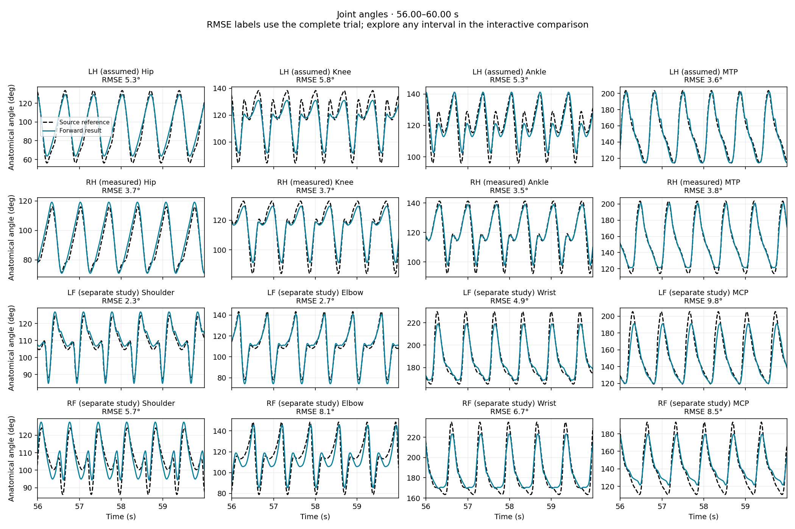
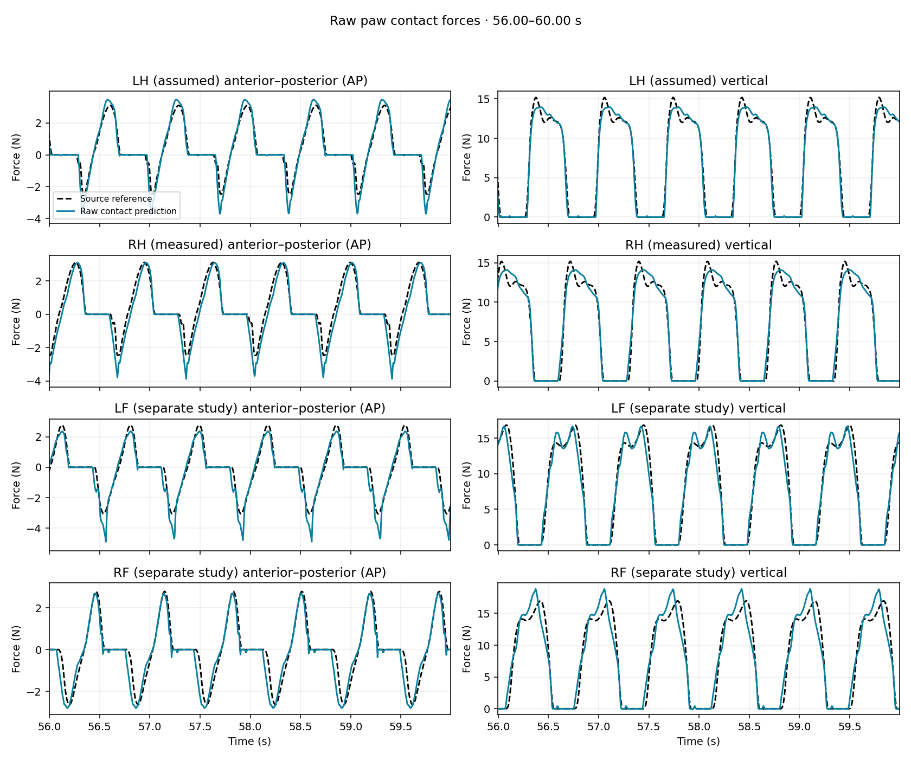

<!-- Generated by Code/simulation_tools/generate_github_guides.py -->

# Joint angles and ground-reaction forces

[Project home](../../README.md) · [Intact walking results](README.md)

These figures compare the forward prediction with the experimental or explicitly
assumed references. They show the final four seconds so individual strides remain
visible. The captions state the interval used to calculate errors. RH is measured;
LH is an assumed mirror; forelimb references are from a separate study.

## Joint angles

## Ground-reaction forces

## Browse the whole trial locally

Download and extract the entire repository, then open `START_HERE.html` and follow
**Results → interactive joint angles and GRFs**. The interactive HTML provides a
four-second moving window, time slider, Start/Middle/End buttons and limb selection
over the full 60-second result. GitHub's Markdown view displays the static figures;
it does not run those JavaScript controls.

- [Joint-angle time series](Joint_Kinematics/README.md)
- [GRF time series](Ground_Reaction_Forces/README.md)
- [Full numerical results](forward_simulation_timeseries.npz)
- [Comparison metrics](experimental_comparison_metrics.json)
