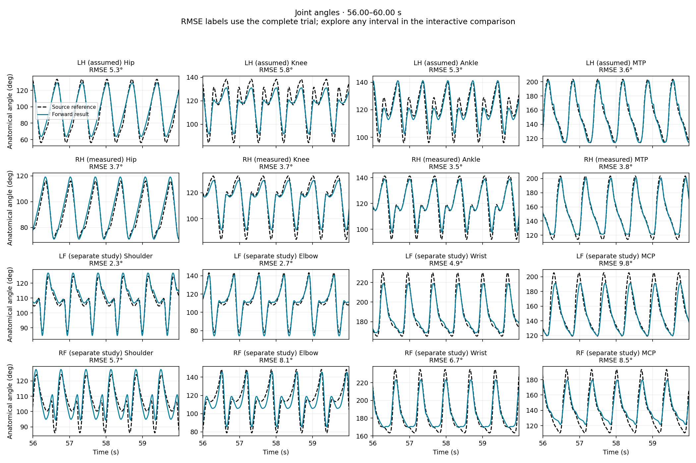
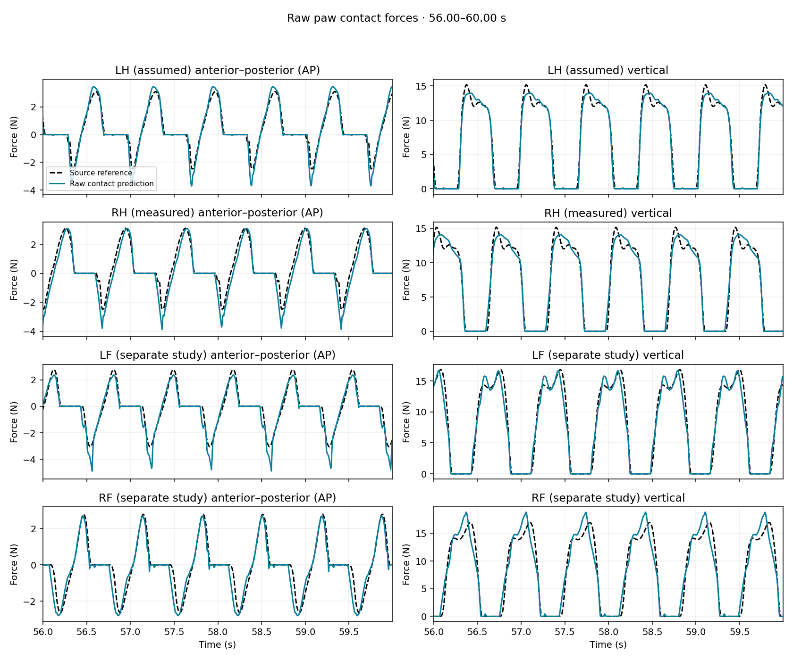
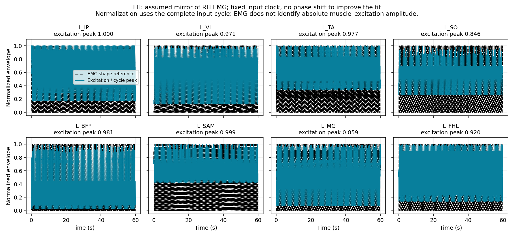
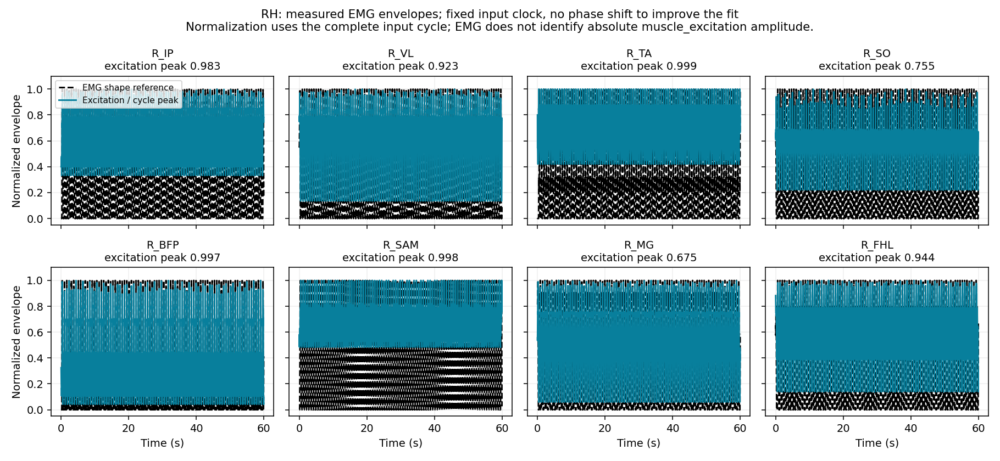
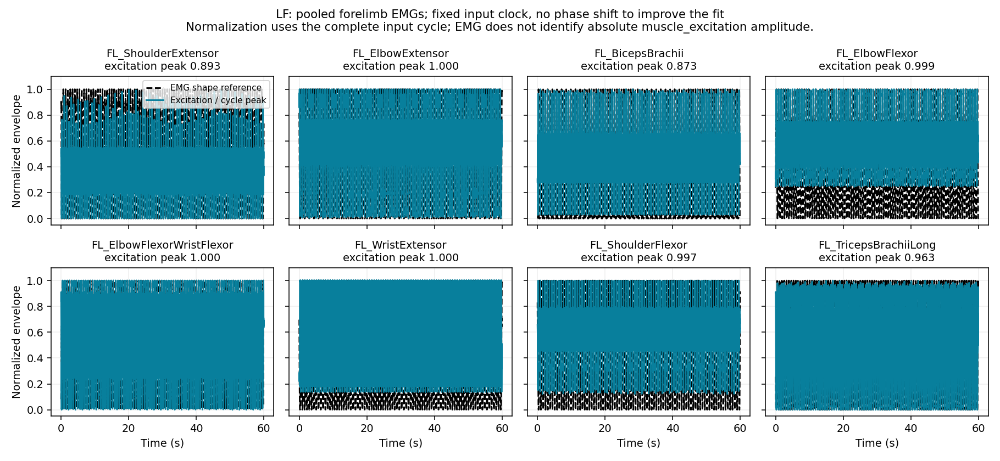
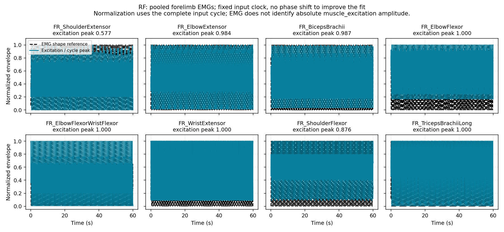

<!-- Generated by Code/simulation_tools/generate_github_guides.py -->

# Intact-cat forward simulation

[Project home](../../README.md) · [Folder guide](../../Documentation/project_structure.md)

Four-limb forward fit

Duration: 59.996 s. Failure: none detected within this run. Duration alone does not establish complete experimental agreement or stability beyond the simulated interval.

The four limbs are mechanically coupled. Excitation drives activation, muscle forces transmitted through elastic tendons and native articulated dynamics. GRFs come from physical paw contact. Raw reference curves and raw forward outputs use the same clock.

[**Explore all time points: movable four-second window, joint angles and GRFs**](interactive_experimental_comparison.md)

Static figures show the final four seconds. The table and plot-title RMSE values use the complete saved trial, without phase shifting.

| Limb and data basis | Joint RMSE (degrees, proximal to distal) | AP GRF RMSE (N) | Vertical GRF RMSE (N) |
| --- | --- | --- | --- |
| LH: assumed mirror | 5.26, 5.76, 5.34, 3.63 | 0.42 | 0.71 |
| RH: measured Ted_046 | 3.68, 3.74, 3.53, 3.83 | 0.55 | 0.90 |
| LF: separate-study mean; pooled EMG | 2.29, 2.66, 4.86, 9.82 | 0.49 | 1.25 |
| RF: separate-study mean; pooled EMG | 5.67, 8.10, 6.69, 8.48 | 0.48 | 1.83 |

LH is assumed from RH. Forelimb recordings are from a separate study; EMGs are pooled across sides. These are fitting targets, not simultaneous four-limb validation.

## Excitation shapes compared with available EMG

[All metrics, including each EMG channel](experimental_comparison_metrics.json) · [Applied parameters](settings.json) · [Equations, sources and assumptions](../../Documentation/model_methods.md)

[Actual applied parameter table](applied_parameters.md) · [Machine-readable values](APPLIED_PARAMETERS.json) · [Frozen config/reference hashes](INPUT_HASHES.json) · [Walking acceptance checks](walking_quality_metrics.json)

[Actual muscle origins, insertions, via points and wrapping](ATTACHMENT_MAP.md) · [Connection and coordinate data](ATTACHMENT_MAP.json)
